# Arquitectura de ms-template (backend)

Cómo se concretan en este template los [lineamientos de arquitectura](architecture/modular-microservice.md).
Cada sección indica el lineamiento que aplica; la notación de los diagramas es la misma. El
[README](../README.md) es la guía de uso; este documento explica la estructura y sus reglas.

## Parte II: concreción en ms-template

## 10. Stack y mapa del repositorio

NestJS 11 sobre Express, TypeORM 0.3, TypeScript 5 (`strictNullChecks`, `noImplicitAny`),
`class-validator`/`class-transformer`, pino (`nestjs-pino`), `@nestjs/terminus`, `@nestjs/swagger`
para generar OpenAPI y Scalar para renderizarlo. Node ≥ 22, pnpm 11. Aplica las capas de la
[§3](architecture/modular-microservice.md#3-capas).

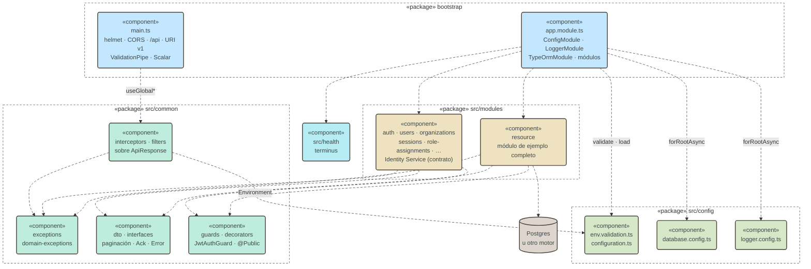

Mapa del repositorio:

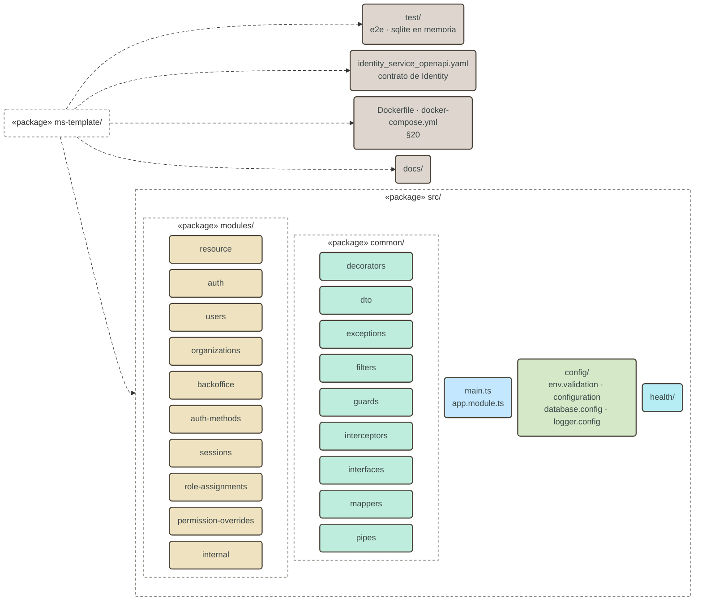

Rutas resultantes:

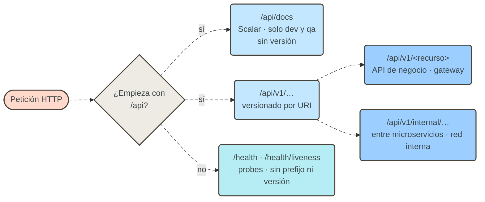

## 11. Módulo de ejemplo: `resource`

Es un módulo en la etapa de reglas ([§4.9](architecture/modular-microservice.md#49-cómo-crece-un-módulo)) y
la plantilla que se copia para crear uno nuevo.

Archivos del módulo:

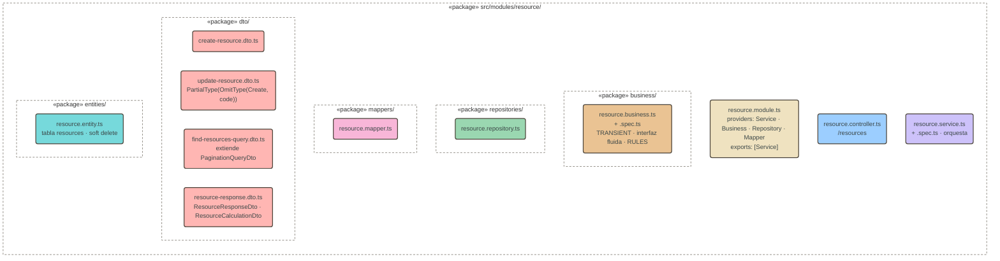

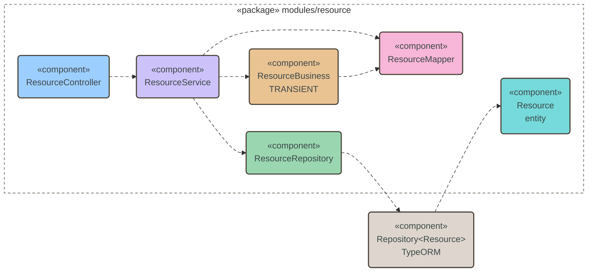

| Método y ruta                    | Service     | Business                                                                                       | Respuesta                        |
| -------------------------------- | ----------- | ---------------------------------------------------------------------------------------------- | -------------------------------- |
| `POST /resources`                | `create`    | —                                                                                              | `201` · `ResourceResponseDto`    |
| `GET /resources`                 | `findAll`   | —                                                                                              | `200` · paginado                 |
| `GET /resources/:id`             | `findOne`   | —                                                                                              | `200`                            |
| `GET /resources/:id/calculation` | `calculate` | `validateEligibility · applyDraftPenalty · applyVolumeDiscount · enforceMinimumAmount · round` | `200` · `ResourceCalculationDto` |
| `PATCH /resources/:id`           | `update`    | `validateEligibility · applyChanges` (→ `transitionTo`)                                        | `200`                            |
| `DELETE /resources/:id`          | `remove`    | —                                                                                              | `204` · soft delete              |

Decisiones que el módulo fija como referencia:

- **Fail-fast en el repository.** `findOneById`, `findOneByCode` y
  `findWithRelationsForCalculation` lanzan `EntityNotFoundException`; `create` lanza
  `DuplicateEntityException` si el `code` existe. El service no tiene ningún `if`.
- **Business transient y síncrono.** `TRANSIENT` da una instancia por consumidor, no por request:
  el service singleton la comparte entre requests. Es seguro porque la cadena no tiene `await` y
  `init()` resetea el estado. Si una regla necesitara E/S, se resuelve en el service antes de
  `init()`; si eso no alcanza, el scope pasa a `Scope.REQUEST`.
- **Trazabilidad de reglas.** Cada regla aplicada agrega una línea a `appliedRules`, que viaja en
  la respuesta del cálculo.
- **Máquina de estados explícita.** `transitionTo` declara las transiciones permitidas en un mapa
  (`DRAFT → ACTIVE|CLOSED`, `ACTIVE → SUSPENDED|CLOSED`, `SUSPENDED → ACTIVE|CLOSED`, `CLOSED → ∅`).
- **Parámetros de negocio como constantes.** `RULES` vive en el business; se mueve a `config/` solo
  si debe variar por entorno.
- **Entidad portable.** `varchar` en vez de `enum` nativo, `decimal` con transformer a `number`,
  fechas sin `type` explícito, `@DeleteDateColumn` para soft delete (§16).

## 12. Secuencia: calcular un recurso

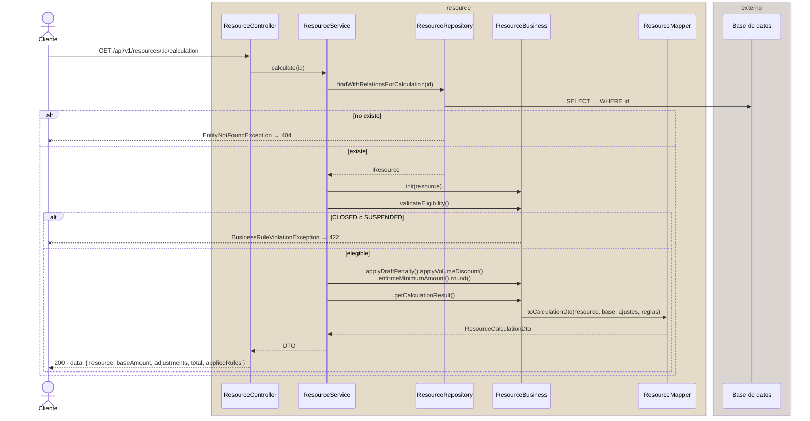

### 12.1. Secuencia: eliminar un recurso

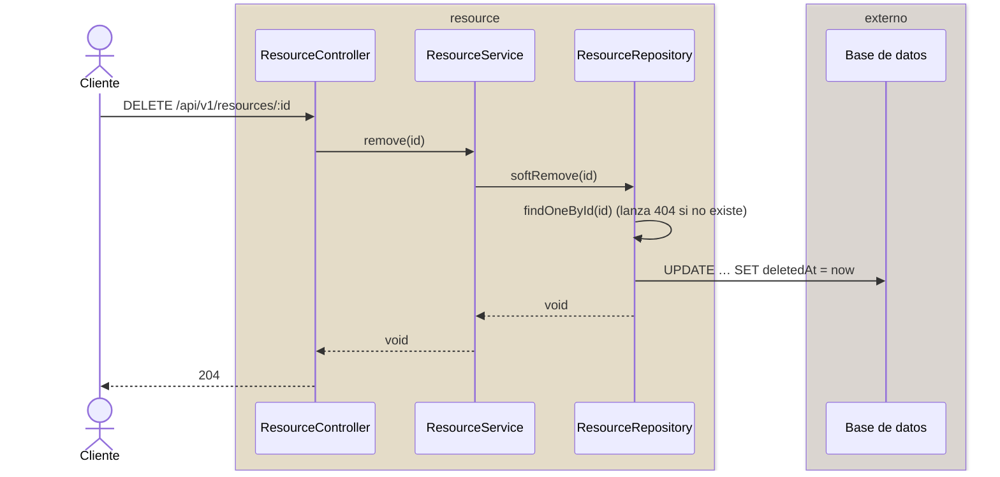

El registro queda en la tabla con `deletedAt`; TypeORM lo excluye de las lecturas siguientes.

## 13. Formas de un módulo: Identity Service

Los nueve módulos restantes implementan el contrato de `identity_service_openapi.yaml` en la etapa
de contrato ([§4.9](architecture/modular-microservice.md#49-cómo-crece-un-módulo)): controllers, DTOs y
services que devuelven stubs tipados con `TODO(RFn)`. Las carpetas `business/`, `entities/`,
`mappers/` y `repositories/` existen con `.gitkeep`.

| Módulo                 | Controllers y ruta base                            | Guard                                       |
| ---------------------- | -------------------------------------------------- | ------------------------------------------- |
| `auth`                 | `/auth` (login, SSO, verify-email, password-reset) | `JwtAuthGuard`; todas las rutas `@Public()` |
| `users`                | `/users` · `/organizations/:id/users`              | `JwtAuthGuard`                              |
| `organizations`        | `/organizations/:id/transfer-ownership`            | `JwtAuthGuard`                              |
| `backoffice`           | `/backoffice` · `/backoffice-client-access`        | `JwtAuthGuard`                              |
| `auth-methods`         | `/auth-methods` · `/users/me/mfa`                  | `JwtAuthGuard`                              |
| `sessions`             | `/sessions` · `/users/me/sessions`                 | `JwtAuthGuard`                              |
| `role-assignments`     | `/role-assignments`                                | `JwtAuthGuard`                              |
| `permission-overrides` | `/permission-overrides`                            | `JwtAuthGuard`                              |
| `internal`             | `/internal/authorize`                              | ninguno (§13.1)                             |

Dependencias actuales entre módulos (solo tipos de `dto/`, sin dependencia en tiempo de ejecución,
[§6.1](architecture/modular-microservice.md#61-dependencias-entre-módulos)):

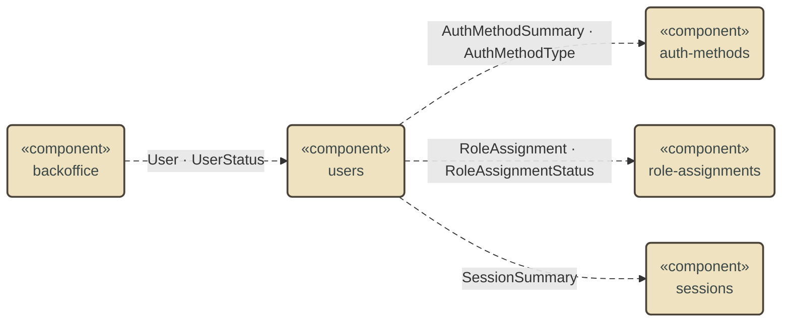

El grafo no tiene ciclos. Cuando estos módulos ganen persistencia, una necesidad de **datos** (no
de forma) se resuelve importando el módulo y su service exportado, nunca su repository.

### 13.1. Rutas internas

`internal` no lleva `JwtAuthGuard` a propósito: el OpenAPI declara `security: []` y la ruta solo es
alcanzable por red interna (mTLS a nivel de infraestructura o service mesh). La protección es de
red, no de aplicación; esta ruta nunca se publica en el API Gateway.

### 13.2. Convenciones heredadas del contrato

Los DTOs de Identity siguen el OpenAPI, no las convenciones de `resource`:

| Aspecto          | `resource`                          | Identity (OpenAPI)                           |
| ---------------- | ----------------------------------- | -------------------------------------------- |
| Nombre de clase  | `CreateResourceDto`, `…ResponseDto` | `CreateUserRequest`, `User`, `TokenPair`     |
| Propiedades      | `camelCase`                         | `snake_case` (`full_name`, `created_at`)     |
| Valores de enum  | inglés (`ACTIVE`)                   | español (`ACTIVO`, `PENDIENTE_VERIFICACION`) |
| Fechas en el DTO | `Date`                              | `string` ISO 8601                            |

Cuando el contrato lo fija un OpenAPI externo, manda el contrato. `common/dto/error.dto.ts` exporta
una clase `Error` que tapa al `Error` nativo: se importa siempre con alias
(`import { Error as ErrorDto } …`).

## Parte III: capacidades transversales

## 14. Configuración y entornos (`src/config`)

Aplica la [§9](architecture/modular-microservice.md#9-arranque-y-entornos).

- `env.validation.ts` declara `EnvironmentVariables` y `validateEnv`. Toda variable nueva se agrega
  ahí con tipo explícito (`PORT: number = 3000`) y `@Type(() => Number)` si es numérica; sin
  anotación, `design:type` es `Object` y la validación falla con cualquier valor.
- `configuration.ts` expone tres namespaces (`app`, `docs`, `logger`) con `registerAs`. Los módulos
  leen por `ConfigService`, no por `process.env`.
- `NODE_ENV` admite solo `dev`, `qa`, `prod` (enum `Environment`). Como Express espera
  `'production'`, `main.ts` hace `app.set('env', 'production')` cuando el entorno es `prod`.

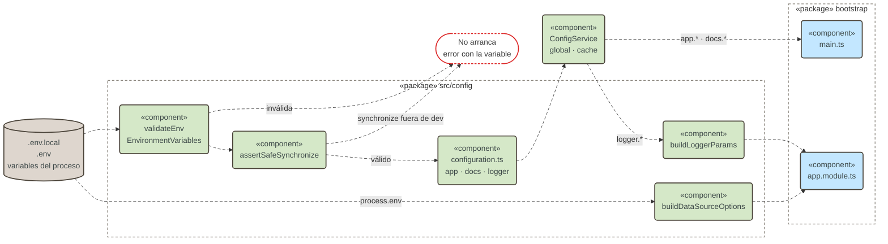

Qué decide cada entorno:

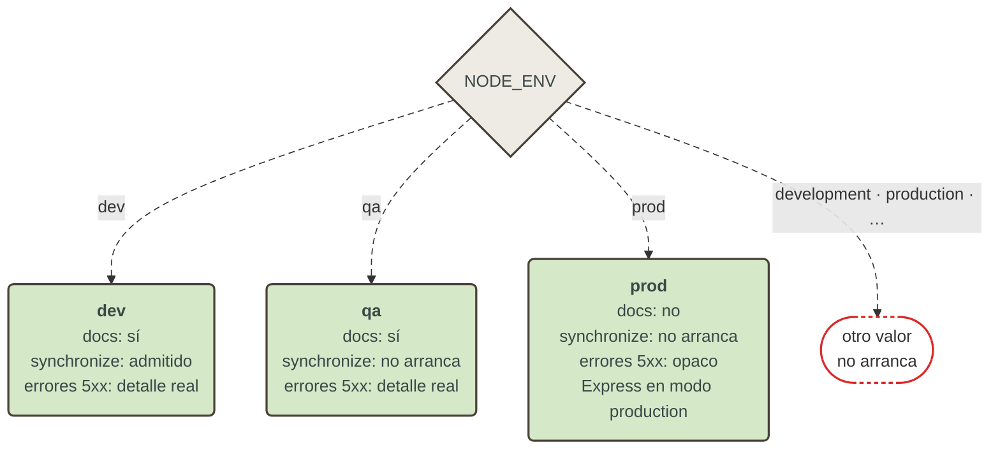

| Comportamiento               | `dev` |      `qa`      |     `prod`     | Dónde se decide                                                             |
| ---------------------------- | :---: | :------------: | :------------: | --------------------------------------------------------------------------- |
| Documentación en `/api/docs` |  sí   |       sí       |     **no**     | `DOCS_ALLOWED_ENVS` · `docsConfig`                                          |
| `DB_SYNCHRONIZE=true`        |  sí   | **no arranca** | **no arranca** | `SYNCHRONIZE_ALLOWED_ENVS` · `assertSafeSynchronize` · `resolveSynchronize` |
| Detalle real de errores 5xx  |  sí   |       sí       |   **opaco**    | `GlobalExceptionFilter.exposeInternals`                                     |

## 15. Contrato de respuesta y errores (`src/common`)

Aplica el principio 5 y la [§7.3](architecture/modular-microservice.md#73-errores).

`ResponseInterceptor` envuelve todo retorno en `ApiResponse<T>`; si el retorno es un
`PaginatedResultDto`, pone `items` en `data` y la metadata en `meta.pagination`.
`GlobalExceptionFilter` (`@Catch()` sin filtro) produce el mismo sobre con `success: false`,
`data: null` y `errors[]`.

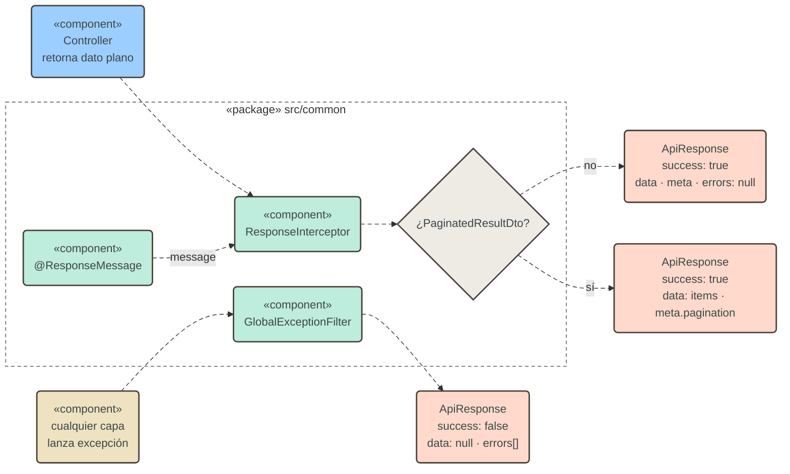

```json
{
  "success": true,
  "statusCode": 200,
  "message": "OK",
  "data": {},
  "meta": { "timestamp": "…", "path": "…" },
  "errors": null
}
```

El filtro resuelve en este orden:

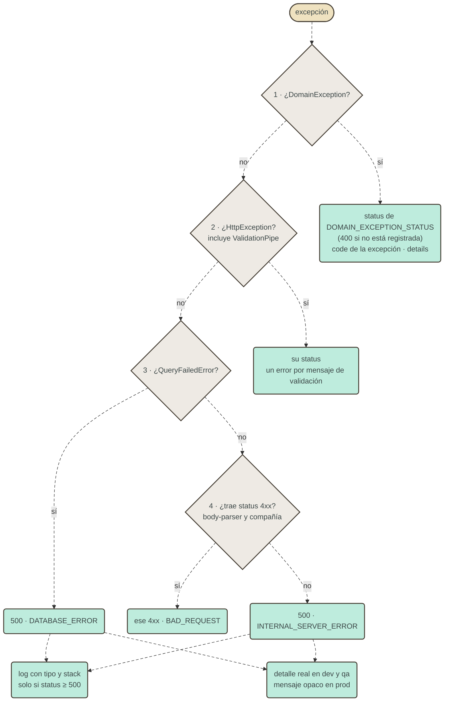

Jerarquía de excepciones de dominio:

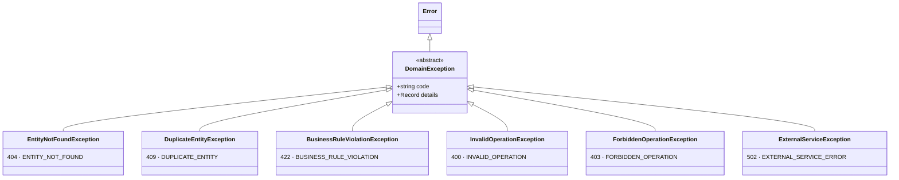

| Excepción de dominio             | HTTP | `code`                    |
| -------------------------------- | ---- | ------------------------- |
| `EntityNotFoundException`        | 404  | `ENTITY_NOT_FOUND`        |
| `DuplicateEntityException`       | 409  | `DUPLICATE_ENTITY`        |
| `BusinessRuleViolationException` | 422  | `BUSINESS_RULE_VIOLATION` |
| `InvalidOperationException`      | 400  | `INVALID_OPERATION`       |
| `ForbiddenOperationException`    | 403  | `FORBIDDEN_OPERATION`     |
| `ExternalServiceException`       | 502  | `EXTERNAL_SERVICE_ERROR`  |

Una excepción nueva extiende `DomainException` en `domain-exceptions.ts` **y** se registra en
`DOMAIN_EXCEPTION_STATUS`; si no, cae en 400 por defecto.

Documentación del sobre en OpenAPI: `@ApiStandardResponse(Dto, status, descripción)` y
`@ApiPaginatedResponse(Dto)`. El mensaje se personaliza con `@ResponseMessage('…')`.

`ValidationPipe` global: `whitelist`, `forbidNonWhitelisted`, `transform`, sin conversión
implícita. Un campo no declarado en el DTO es un 400.

## 16. Persistencia y portabilidad (`database.config.ts`)

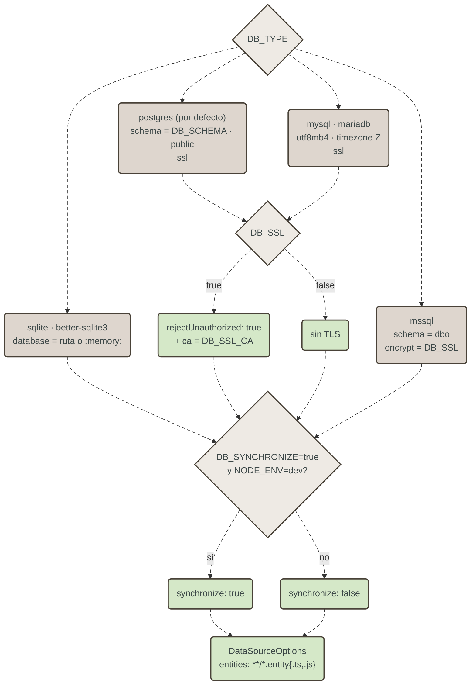

- `buildDataSourceOptions(env)` es la única fuente de verdad de la conexión. Cambiar de motor es
  cambiar `DB_TYPE` e instalar el driver (`pg` incluido; `mysql2`, `mssql`, `sqlite3` a pedido;
  `better-sqlite3` como devDependency para e2e).
- Las entidades se registran por glob (`**/*.entity{.ts,.js}`): un módulo nuevo no toca la
  configuración del ORM, solo declara `TypeOrmModule.forFeature([Entidad])`.
- Tipos portables: sin `enum` nativo, `jsonb` ni `uuid` propietario; fechas sin `type` explícito.
- TLS: con `DB_SSL=true`, `rejectUnauthorized` es siempre `true`; una CA propia va en `DB_SSL_CA`.
- `synchronize`: apagado por defecto, permitido solo en `dev`, con doble barrera (validación de
  entorno y `resolveSynchronize`).
- **Migraciones: todavía no existen.** El README lista lo que hay que reponer (`typeorm.datasource.ts`,
  opciones `migrations*`, `DB_MIGRATIONS_RUN`, scripts). Hasta entonces, el esquema en `qa`/`prod`
  se crea por fuera.

## 17. Seguridad

Barreras por las que pasa cada petición, en el orden de ejecución de Nest:

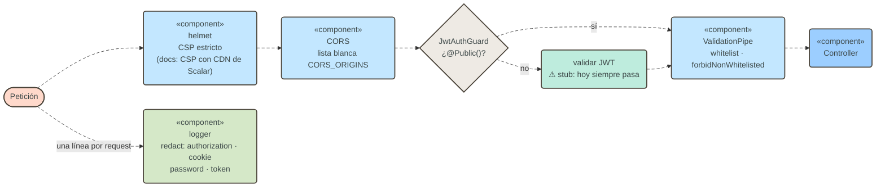

- `helmet()` global con CSP estricto; un segundo `helmet()` solo en la ruta de docs permite el CDN de
  Scalar (`cdn.jsdelivr.net`).
- CORS con lista blanca `CORS_ORIGINS`; vacía = ningún origen cruzado. Nunca `origin: true`.
- Autenticación: `JwtAuthGuard` + `@Public()`. Hoy el guard es un **stub que siempre deja pasar**
  (`TODO: validar JWT real`) y se aplica por controller con `@UseGuards`. El objetivo, según el
  README, es registrarlo como `APP_GUARD` global para que un endpoint olvidado quede cerrado.
- El logger elimina `authorization`, `cookie`, `password` y `token` (`redact.remove`).
- Sin rate limiting: lo resuelve el gateway o cada proyecto.

## 18. Observabilidad

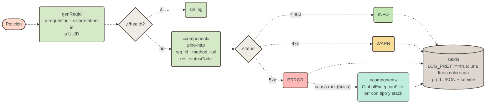

Probes de salud:

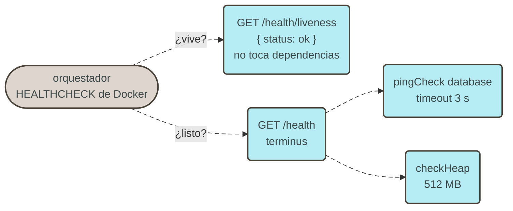

- **Una línea por request** (pino-http): serializers que recortan `req`/`res`, nivel por status
  (5xx `error`, 4xx `warn`, resto `info`), `/health` silenciado.
- **Un solo dueño del stack trace**: `GlobalExceptionFilter`, solo en 5xx. `LoggerErrorInterceptor`
  no se registra y el `err` sintético de pino-http se descarta.
- **Correlación**: `genReqId` respeta `x-request-id` / `x-correlation-id` o genera un UUID. Cada
  línea lleva `service: APP_NAME`.
- `LOG_PRETTY=true` en desarrollo; en `prod`, JSON por línea.
- **Health** (`@nestjs/terminus`): `/health` comprueba la BD (`pingCheck`, 3 s) y el heap (512 MB);
  `/health/liveness` no toca dependencias y es la que usa el `HEALTHCHECK` del contenedor.

## 19. Documentación de la API

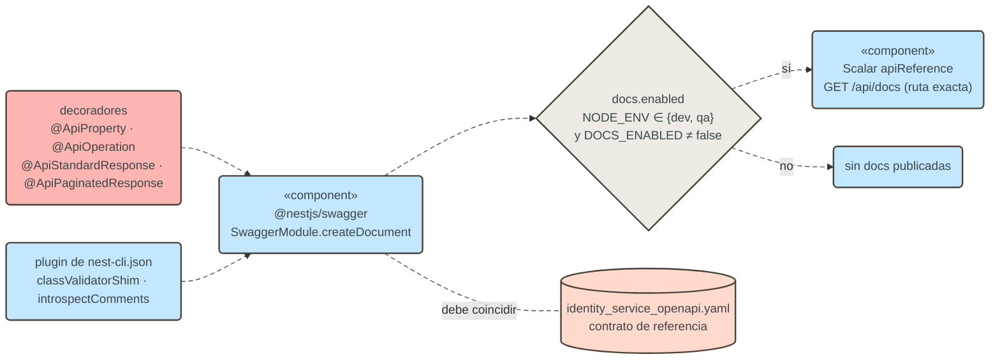

`@nestjs/swagger` genera el documento desde los decoradores y el plugin de `nest-cli.json`
(`classValidatorShim`, `introspectComments`); Scalar lo renderiza en `/<API_PREFIX>/<DOCS_PATH>`
con `server.get` sobre la ruta exacta. No se publica el JSON crudo. Solo en `dev` y `qa`.

Para Identity, `identity_service_openapi.yaml` es el contrato de referencia: el documento que genera
el código debe coincidir con él en rutas, cuerpos y respuestas.

## 20. Empaquetado y despliegue

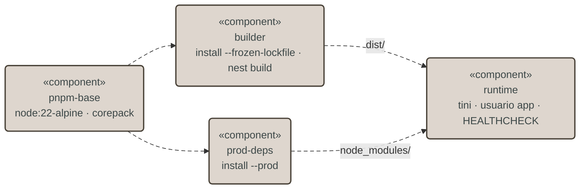

- Imagen multi-etapa; la final no tiene devDependencies ni código fuente, corre como usuario sin
  privilegios bajo `tini`.
- `pnpm-lock.yaml` versionado; en CI, `pnpm install --frozen-lockfile`.
- pnpm bloquea los scripts de instalación: un paquete con binarios nativos se autoriza en
  `pnpm-workspace.yaml > allowBuilds`.
- `docker-compose.yml` levanta `api` (`NODE_ENV=prod`) y `postgres:16`. Como `prod` no admite
  `synchronize`, el esquema no se crea solo (§16).

## Anexo A: verificación

| Comando                          | Verifica                                                                |
| -------------------------------- | ----------------------------------------------------------------------- |
| `pnpm build`                     | Tipos y compilación.                                                    |
| `pnpm lint`                      | ESLint con `recommendedTypeChecked` y Prettier.                         |
| `pnpm test`                      | Unitarios: business, service, config.                                   |
| `pnpm test:e2e`                  | E2E contra sqlite en memoria: sobre, errores, paginación, portabilidad. |
| `pnpm install --frozen-lockfile` | Lockfile sincronizado con `package.json`.                               |

Las reglas de capas y privacidad de la [§6](architecture/modular-microservice.md#6-reglas-de-dependencia-y-privacidad)
**hoy se verifican en revisión**, no con el linter. Para automatizarlas haría falta una regla de
imports (por ejemplo `no-restricted-imports` o un plugin de límites) que prohíba importar
`repositories/`, `business/`, `mappers/` y `entities/` de otro módulo, y la detección de ciclos.

## Anexo B: desvíos conocidos

Estado al 2026-11-03. Cada punto es una diferencia entre este documento y el código.

| Desvío                                                                                                          | Dónde                                 | Efecto                                                                                  |
| --------------------------------------------------------------------------------------------------------------- | ------------------------------------- | --------------------------------------------------------------------------------------- |
| `UpdateResourceDto` redeclara `amount` y `status` como `undefined` y `name`/`description` como obligatorios.    | `resource/dto/update-resource.dto.ts` | `pnpm test` falla al compilar `resource.service.spec.ts` y `resource.business.spec.ts`. |
| La imagen fija `NODE_ENV=production`, valor que `validateEnv` rechaza.                                          | `Dockerfile` (etapa `runtime`)        | El contenedor solo arranca si se sobrescribe `NODE_ENV` (compose lo hace con `prod`).   |
| `JwtAuthGuard` es un stub que siempre deja pasar y se aplica por controller, no como `APP_GUARD`.               | `common/guards/jwt-auth.guard.ts`     | Ningún endpoint está protegido; `resource` ni siquiera declara el guard.                |
| Las reglas de capas no las verifica el linter.                                                                  | `eslint.config.mjs`                   | Ver Anexo A.                                                                            |
| Sin migraciones.                                                                                                | `config/database.config.ts`           | El esquema en `qa`/`prod` se crea por fuera (§16).                                      |
| El contrato `/internal/authorize` vive en un módulo `internal`, organizado por quién lo usa y no por capacidad. | `src/modules/internal/`               | Contradice el principio 1: los módulos se organizan por capacidad de dominio.           |
