# Lineamientos de arquitectura de microservicio modular (backend)

Arquitectura de referencia para un **microservicio modular** (`ms-<dominio>`): un servicio HTTP que
contiene un solo dominio, organizado por módulos. No nombra módulos concretos:
`docs/architecture.md` muestra cómo se aplica en este template.

Un `ms-` nace de extraer un dominio de un monolito modular (`mm-<nombre>`): la
la [guía del monolito modular](modular-monolith.md) describe cómo se organiza uno para que esa
extracción sea mover una carpeta.

| Término     | Qué es                                                                                                | Ejemplo                 |
| ----------- | ----------------------------------------------------------------------------------------------------- | ----------------------- |
| **Dominio** | Contexto acotado de negocio, con datos, reglas y lenguaje propios. Un `ms-` contiene exactamente uno. | `identity`, `academic`  |
| **Módulo**  | Una capacidad dentro del dominio, con la anatomía de la [§4](#4-anatomía-de-un-módulo).               | `users`, `sessions`     |
| **Evento**  | Hecho de negocio ya ocurrido, publicado por el dominio dueño ([§11](#11-eventos)).                    | `identity.user.created` |

## 1. Principios

1. **Por módulo de dominio; dentro, por rol técnico.** Todo lo de una capacidad vive en su carpeta
   de `modules/`; dentro de ella, cada pieza tiene un rol fijo (controller, service, business, lib,
   repository, mapper, models, entidad).
2. **Dependencias en una sola dirección y sin ciclos.** Los módulos usan `common` y `config`, nunca
   al revés. Un módulo usa otro por su contrato público, nunca por una pieza interna.
3. **Cada pieza hace una sola cosa.** El controller recibe, el service coordina, el business
   concentra la lógica de negocio, el lib ofrece cálculos puros genéricos, el repository consulta, el
   mapper traduce.
4. **El modelo de persistencia no sale del módulo.** La entidad ORM no se expone al cliente ni a
   otro módulo: hacia afuera viajan DTOs.
5. **Un solo contrato de respuesta.** Éxitos y errores salen con el mismo sobre, armado por piezas
   transversales; ningún controller lo arma a mano.
6. **Fallar pronto y en el lugar correcto.** El entorno inválido impide arrancar; lo que no existe
   lo detecta el repository; la regla rota la detecta el business. Cada capa lanza excepciones de
   dominio y una sola pieza las traduce a HTTP.
7. **Seguro por defecto.** Lo peligroso (sincronizar esquema, publicar docs, CORS abierto, detalle de
   errores) está apagado salvo que el entorno lo admita expresamente.
8. **Extender copiando el módulo de ejemplo.** Un módulo nuevo nace de la plantilla; no se crean
   capas ni carpetas que el módulo no necesita todavía.
9. **Solo `integrations/` sale del servicio.** Toda llamada a otro servicio pasa por
   `integrations/`; ningún módulo abre una conexión HTTP por su cuenta
   ([§8](#8-integraciones-y-orquestación)).

## 2. Contexto

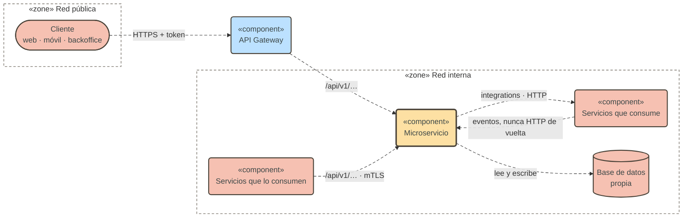

- Cada microservicio es dueño de su base de datos; ningún otro servicio la lee directamente.
- El tráfico de usuarios entra por el gateway con un token; el gateway es la frontera entre la red
  pública y la interna y enruta hacia la API (`/api/v1/…`) de cada microservicio.
- Las probes de salud (`/health`) quedan fuera del prefijo y de la versión de la API.
- Lo que entra de otros servicios usa la misma API de los módulos; lo que sale hacia ellos pasa por
  `integrations/` ([§8](#8-integraciones-y-orquestación)).
- Un mismo servicio no puede estar a ambos lados con llamadas síncronas: si este microservicio lo
  consume, la dirección de vuelta va por eventos ([§8.4](#84-reglas), regla 13;
  [§11](#11-eventos)).

## 3. Capas

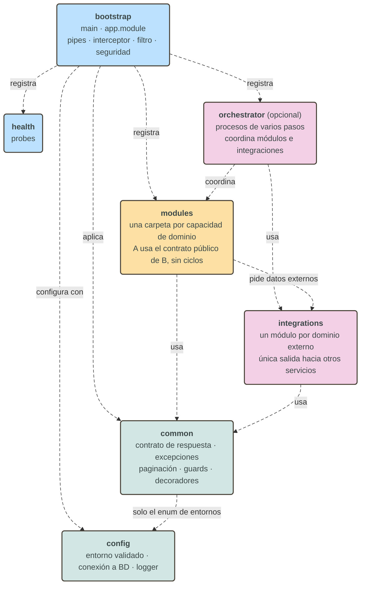

| Capa           | Responsabilidad                                                                                                                                                              | Puede depender de                                             | No depende de                                                    |
| -------------- | ---------------------------------------------------------------------------------------------------------------------------------------------------------------------------- | ------------------------------------------------------------- | ---------------------------------------------------------------- |
| `bootstrap`    | Arrancar, aplicar lo transversal (seguridad, validación, sobre, errores) y registrar.                                                                                        | `modules`, `orchestrator`, `health`, `common`, `config`       | —                                                                |
| `orchestrator` | Coordinar un proceso de varios pasos que no pertenece a un solo módulo (opcional).                                                                                           | contrato público de los módulos, `integrations`, `common`     | Piezas internas de los módulos; otro orchestrator                |
| `modules`      | Implementar cada capacidad de dominio.                                                                                                                                       | `common`, contrato público de otro módulo y de `integrations` | `orchestrator`; piezas internas de otro módulo; `config` directo |
| `integrations` | Consumir lo que está fuera del dominio y entregarlo como tipos propios: otros servicios. En un [monolito modular](modular-monolith.md#2-estructura), también otros dominios. | `common`, `ConfigService`                                     | `modules`, `orchestrator`                                        |
| `health`       | Informar si el proceso y sus dependencias responden.                                                                                                                         | `common`                                                      | `modules`                                                        |
| `common`       | Piezas transversales sin dominio: sobre de respuesta, excepciones, paginación, guards.                                                                                       | `config` (solo el enum de entornos)                           | `modules`, `orchestrator`, `integrations`                        |
| `config`       | Leer y validar el entorno; construir conexión a BD y logger.                                                                                                                 | —                                                             | `modules`, `orchestrator`, `integrations`, `common`              |

Un módulo no lee `process.env`: recibe la configuración por `ConfigService` o por parámetros. La
única excepción hacia `config` desde `common` es el enum de entornos que usa el filtro de errores
para decidir si expone el detalle.

## 4. Anatomía de un módulo

Un módulo implementa una capacidad del dominio (usuarios, sesiones, pagos). Reúne en una carpeta de
`modules/` todo lo de esa capacidad: su API HTTP, sus reglas, sus datos y sus definiciones. Hacia
afuera solo expone su service y sus DTOs y enums; lo demás es interno
([§6](#6-reglas-de-dependencia-y-privacidad)).

`<x>` es el nombre del módulo en singular (`resource`, `user`); `<X>`, el mismo nombre en
PascalCase (`Resource`, `User`).

### 4.1. Archivos principales

```
modules/<x>/
├── <x>.module.ts
├── <x>.controller.ts
├── <x>.service.ts
└── <x>.service.spec.ts
```

Todo módulo los tiene desde que nace.

- **`<x>.module.ts`**: declara los controllers, registra como providers el
  service y las piezas de las carpetas (repository, mapper, business) e importa
  `TypeOrmModule.forFeature([<X>])` si el módulo tiene entidad y los módulos de `integrations/` que
  usa. **Exporta solo el service** ([§6](#6-reglas-de-dependencia-y-privacidad)).
- **`<x>.controller.ts`**: declara las rutas, valida la entrada con DTOs y pipes, documenta el
  endpoint y delega en el service. Devuelve el dato plano: no arma el sobre de respuesta ni captura
  excepciones. Un módulo puede tener más de un controller cuando sus rutas cuelgan de recursos
  distintos (por ejemplo `/<x>` y `/<padre>/:id/<x>`, en `<padre>-<x>.controller.ts`); todos
  delegan en el mismo service.
- **`<x>.service.ts`**: coordina repository, business, mapper, services de otros módulos y clients
  de `integrations/`; no decide, no consulta y no calcula. Es la única pieza que otros módulos pueden usar.
- **`<x>.service.spec.ts`**: nace cuando el service deja de devolver stubs.

### 4.2. `models/`: DTOs, enums, interfaces, tipos y constantes

```
modules/<x>/models/
├── dto/
│   ├── create-<x>.dto.ts
│   ├── update-<x>.dto.ts
│   ├── find-<x>s-query.dto.ts
│   └── <x>-response.dto.ts
├── enums/
│   └── <x>-status.enum.ts
├── interfaces/
│   └── <x>-<forma>.interface.ts
├── types/
│   └── <x>.types.ts
└── constants/
    └── <x>.constants.ts
```

- **`dto/`** (público): el contrato HTTP con el cliente.
  - `create-<x>.dto.ts`: el cuerpo de creación, con `class-validator` en cada campo.
  - `update-<x>.dto.ts`: `PartialType(OmitType(Create<X>Dto, [campos inmutables]))`. No vuelve a
    declarar los campos que hereda.
  - `find-<x>s-query.dto.ts`: los parámetros de un listado. Extiende `PaginationQueryDto` y suma sus
    filtros.
  - `<x>-response.dto.ts`: la salida. Nunca es la entidad, y solo la arma el mapper.
  - Existen los DTOs que las rutas necesitan: un módulo sin listado no tiene `find-…-query.dto.ts`.
- **`enums/`** (público): valores cerrados del dominio (estados, tipos), uno por archivo.
- **`interfaces/`** (privado): formas internas que no son contrato HTTP: el resultado del business, los datos
  que recibe el mapper, las opciones de un método.
- **`types/`** (privado): alias y uniones de tipos (`type <X>Code = string`, uniones de literales).
- **`constants/`** (privado): valores fijos que no son reglas de negocio: largos máximos, valores
  por defecto, claves. Los umbrales y tasas van en el business ([§4.6](#46-business-reglas-de-negocio)).

Reglas:

- **Solo definiciones.** Sin lógica, sin E/S, sin services ni ORM. Los DTOs pueden usar los
  decoradores de `class-validator`, `class-transformer` y `@nestjs/swagger`.
- **No depende del resto del módulo.** Las demás piezas importan de `models/`; `models/` no importa
  de ninguna de ellas.
- **Cada subcarpeta aparece cuando hace falta.** Un módulo de contrato suele tener solo `dto/` y
  `enums/`.
- **La entidad no va aquí:** vive en `entities/`.
- Si un OpenAPI externo fija los nombres y la forma de los DTOs, manda el contrato.

### 4.3. `entities/`: modelo de persistencia

```
modules/<x>/entities/
└── <x>.entity.ts
```

- Usa tipos portables entre motores: sin `enum` nativo, `jsonb` ni `uuid` propietario.
- No sale del módulo (principio 4).

### 4.4. `repositories/`: consultas

```
modules/<x>/repositories/
└── <x>.repository.ts
```

- Es la única pieza que inyecta `Repository<<X>>`, `DataSource` o `EntityManager`.
- Si busca por identificador y no encuentra, **lanza** `EntityNotFoundException`: el retorno es
  `Promise<T>`, nunca `Promise<T | null>`. Si el dato ya existe, lanza `DuplicateEntityException`.
- Los listados devuelven `PaginatedResultDto<T>`, nunca un array suelto.
- Uno por entidad.

### 4.5. `mappers/`: entidad → DTO

```
modules/<x>/mappers/
└── <x>.mapper.ts
```

- Convierte la entidad en DTO de salida con funciones puras.
- Es el único lugar donde se arma un DTO de salida.

### 4.6. `business/`: reglas de negocio

```
modules/<x>/business/
├── <x>.business.ts
└── <x>.business.spec.ts
```

- **Centraliza la lógica de negocio completa** del módulo: reglas, validaciones, transiciones de
  estado y los cálculos propios del negocio.
- Interfaz fluida: `init(entidad)` abre la cadena y resetea el estado, cada regla devuelve `this` y
  un método terminal entrega el resultado.
- **Todos sus métodos son síncronos.** El service trae lo que las reglas necesitan antes de
  `init()`: de la BD por el repository y de otros servicios por `integrations/`.
- Cuando una regla no se cumple, lanza una excepción de dominio (`BusinessRuleViolationException`).
- Los parámetros de negocio (umbrales, tasas) son constantes del propio business.
- El spec es obligatorio.

### 4.7. `libs/`: cálculos puros genéricos

```
modules/<x>/libs/
├── <cálculo>.lib.ts
└── <cálculo>.lib.spec.ts
```

- **Centraliza cálculos puros transversales o genéricos** que no encierran ninguna regla de negocio:
  redondeos, porcentajes, prorrateos, diferencias de fechas, conversiones de unidades.
- Se nombra por el cálculo (`rounding.lib.ts`), no por el módulo.
- Son deterministas, síncronos y sin estado. No son providers: se importan directo.
- No hacen E/S, no leen configuración, no usan el ORM y no lanzan excepciones de dominio.
- Si otro módulo necesita el mismo cálculo, baja a `common`.

### 4.8. Estructura completa

```
modules/<x>/
├── <x>.module.ts                 # registra controllers y providers · exporta solo el service
├── <x>.controller.ts             # rutas, validación, documentación; delega en el service
├── <x>.service.ts                # coordina: repository · business · mapper
├── <x>.service.spec.ts
│
├── models/                       # solo definiciones; no importa el resto del módulo
│   ├── dto/                      # público: contrato HTTP
│   │   ├── create-<x>.dto.ts     # entrada: class-validator
│   │   ├── update-<x>.dto.ts     # entrada: PartialType(OmitType(Create…, campos inmutables))
│   │   ├── find-<x>s-query.dto.ts # listado: extiende PaginationQueryDto
│   │   └── <x>-response.dto.ts   # salida: nunca la entidad
│   ├── enums/                    # público: <x>-status.enum.ts
│   ├── interfaces/               # privado: resultado del business, datos del mapper
│   ├── types/                    # privado: alias y uniones
│   └── constants/                # privado: valores fijos que no son reglas de negocio
├── events/                       # opcional: esquemas de los eventos que publica (§11)
│   └── <x>-<hecho>.event.ts
├── entities/
│   └── <x>.entity.ts             # modelo ORM, tipos portables
├── repositories/
│   └── <x>.repository.ts         # única puerta al ORM; lanza EntityNotFoundException
├── mappers/
│   └── <x>.mapper.ts             # entidad → DTO de salida
├── business/
│   ├── <x>.business.ts           # reglas, validaciones, transiciones; síncrono
│   └── <x>.business.spec.ts
└── libs/                         # opcional
    ├── <cálculo>.lib.ts          # cálculo puro genérico; no es provider, se importa directo
    └── <cálculo>.lib.spec.ts
```

El módulo `resource` del template tiene todo salvo `libs/` y `events/`.

### 4.9. Cómo crece un módulo

| Etapa        | Cuándo                                                       | Carpetas                                      | Qué cambia                                                                                          |
| ------------ | ------------------------------------------------------------ | --------------------------------------------- | --------------------------------------------------------------------------------------------------- |
| Contrato     | El contrato está acordado y se publica antes que la lógica.  | Archivos principales + `models/`              | El module registra controller y service. El service devuelve stubs tipados con `TODO(<requisito>)`. |
| Persistencia | Hay datos propios que leer o escribir, sin reglas.           | + `entities/` · `repositories/` · `mappers/`  | El module importa `TypeOrmModule.forFeature` y registra repository y mapper. Se acaban los stubs.   |
| Reglas       | Hay un `if` de negocio, un cálculo o una máquina de estados. | + `business/`                                 | El module registra el business. El service encadena `init(…).regla()` en vez de decidir.            |
| —            | Hace falta un cálculo puro genérico, sin regla de negocio.   | + `libs/` (en cualquier etapa)                | Nada en el module: los libs no se registran.                                                        |
| —            | Hace falta un dato o una acción de otro servicio.            | Ninguna (en cualquier etapa)                  | El module importa el módulo de `integrations/`; el service llama al client antes de `init()` (§8).  |
| —            | Solo se combinan datos de otros módulos.                     | Archivos principales + `models/`, sin entidad | El module importa los módulos dueños; el service usa sus services exportados.                       |

## 5. Roles de los elementos

Cómo se relacionan las piezas de un módulo. Qué hace cada una está en la [§4](#4-anatomía-de-un-módulo).

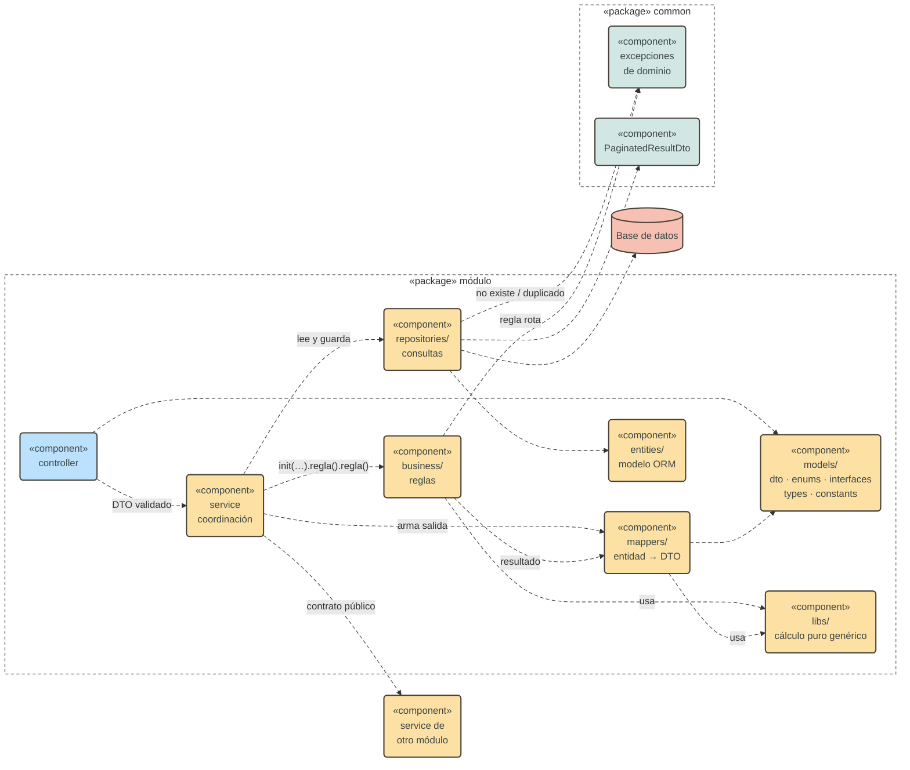

## 6. Reglas de dependencia y privacidad

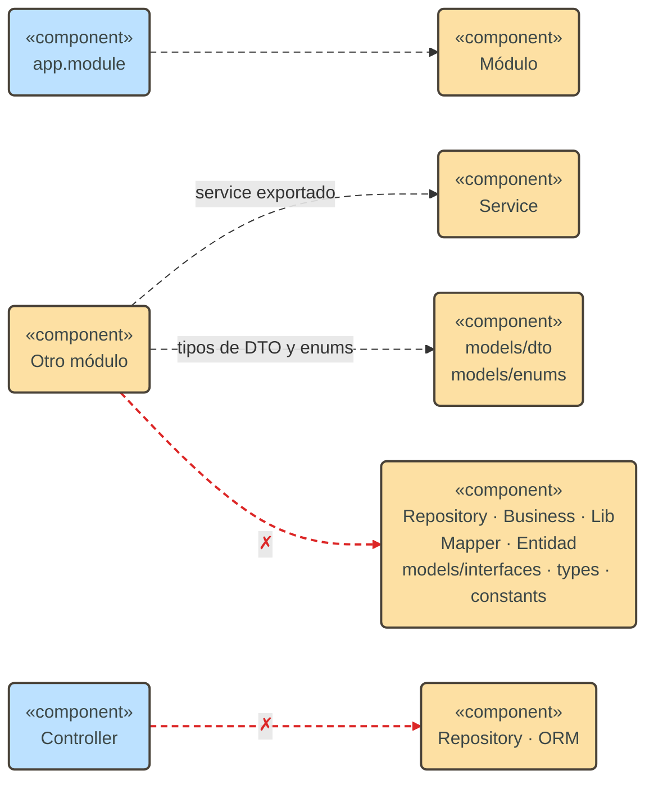

- El contrato público de un módulo es su **service exportado** y sus **DTOs y enums**
  (`models/dto/` y `models/enums/`). Lo demás es privado: entidad, repository, business, lib,
  mapper y `models/interfaces`, `models/types` y `models/constants`.
- Un controller solo inyecta el service de su módulo.
- Ninguna pieza fuera del repository inyecta `Repository<T>`, `DataSource` ni `EntityManager`.
- Ninguna pieza de `modules/` importa `HttpModule`, `HttpService` ni un cliente HTTP: usa el client
  de `integrations/` y sus tipos públicos, nunca su mapper ni sus formas crudas
  ([§8.4](#84-reglas)).
- Nadie fuera de `common/filters` lanza ni traduce `HttpException` por reglas de negocio: se lanzan
  excepciones de dominio.

### 6.1. Dependencias entre módulos

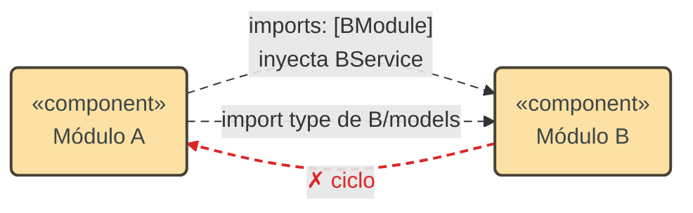

- Si A necesita **datos** de B, importa `BModule` e inyecta `BService`. Nunca el repository de B.
- Si A solo necesita **la forma** de un dato de B (un DTO anidado, un enum), importa el tipo desde
  `B/models/dto/` o `B/models/enums/`. Eso no crea dependencia en tiempo de ejecución.

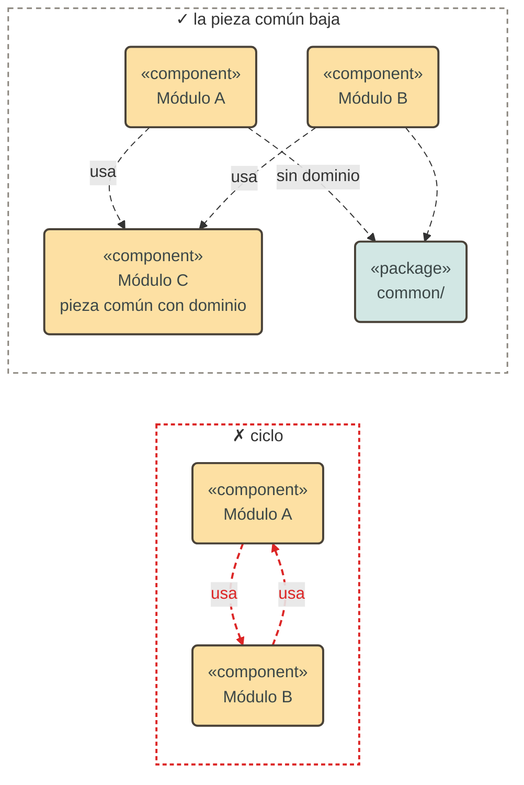

- El grafo entre módulos no tiene ciclos. Si dos módulos se necesitan mutuamente, la pieza común
  baja a un tercer módulo o a `common` (si no tiene dominio).
- `forwardRef` no se usa para esconder un ciclo.
- Si un tipo de B lo usan varios módulos y no pertenece claramente a B, se mueve a `common/dto/`
  solo cuando no tiene dominio; si lo tiene, se queda en su dueño.

## 7. Flujo de una petición

En toda petición, el `ValidationPipe` valida antes de entrar al controller, el interceptor arma el
sobre a la salida y el filtro global traduce cualquier excepción.

### 7.1. Lectura por identificador

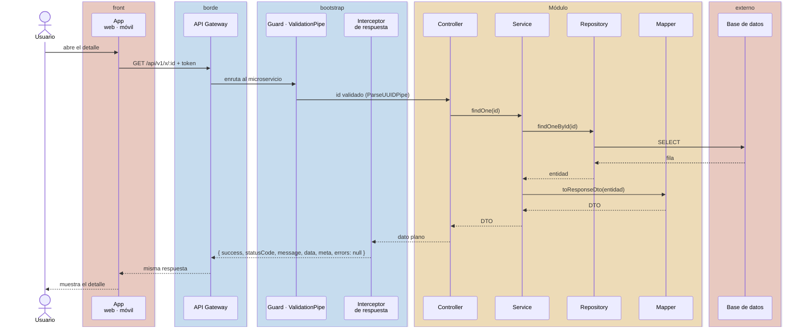

### 7.2. Escritura con reglas de negocio

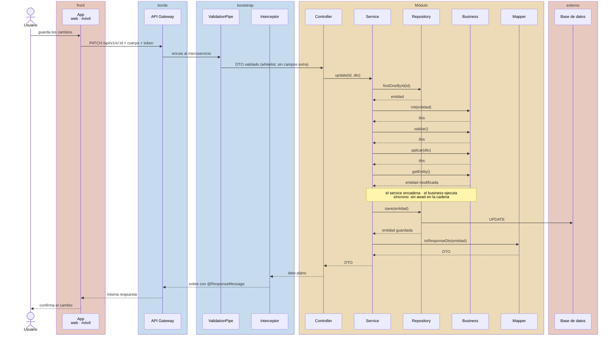

### 7.3. Errores

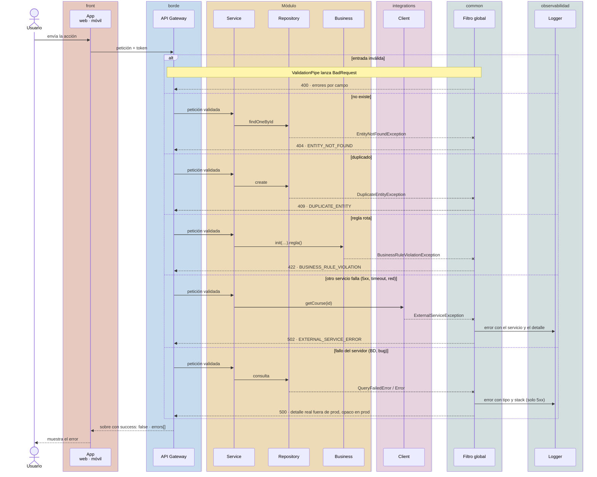

- Los 4xx no imprimen stack: están descritos en la respuesta.
- Los 5xx dejan una sola entrada con stack, la del filtro global. En un 502 el detalle del otro
  servicio queda en el log; el cliente solo ve qué servicio falló.
- Un error de una librería HTTP con status 4xx (por ejemplo, cuerpo demasiado grande) se respeta y
  no se convierte en 500.

### 7.4. Listado paginado

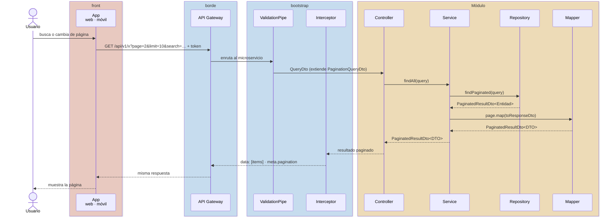

## 8. Integraciones y orquestación

Dos piezas opcionales viven en paralelo a `modules/`, y cada una tiene una sola responsabilidad:

| Carpeta         | Responsabilidad                                                         | Posición                                                 | Nace cuando                                                   |
| --------------- | ----------------------------------------------------------------------- | -------------------------------------------------------- | ------------------------------------------------------------- |
| `integrations/` | Llamar a otros servicios y entregar sus datos como tipos propios.       | **Debajo** de los módulos: ellos la usan.                | Aparece la primera llamada a otro servicio.                   |
| `orchestrator/` | Coordinar un proceso de varios pasos que no pertenece a un solo módulo. | **Encima** de los módulos: los usa, ellos no la conocen. | Un proceso escribe en varios módulos o necesita compensación. |

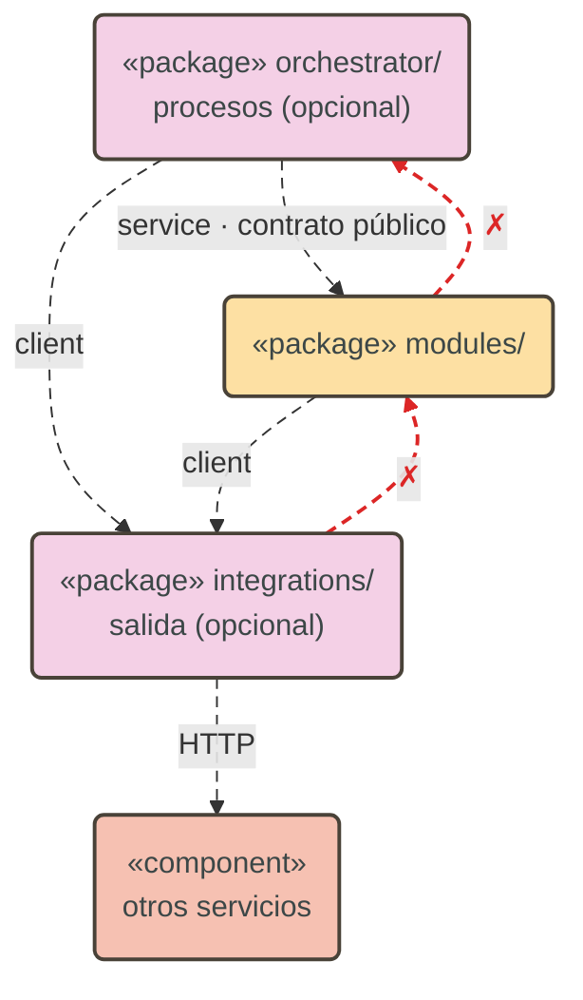

Las §8.1 a §8.5 describen `integrations/`; la §8.6, `orchestrator/`.

### 8.1. Integraciones: estructura

Cuando un módulo necesita un dato o una acción de otro servicio, no lo llama por su cuenta: lo pide
a `integrations/`, la única puerta de salida del microservicio. Es a los otros servicios lo que el
repository es a la base de datos. Por dentro se organiza en módulos, **uno por dominio externo**
(`academic`, `billing`): cada carpeta es dueña de lo suyo y crece sin mezclarse con las demás.

```
src/integrations/
├── common/                                 # base HTTP compartida; solo la usa integrations
│   ├── http-client.factory.ts              # baseUrl · timeout · x-request-id · identidad
│   └── external-error.mapper.ts            # respuesta externa → excepción de dominio
├── academic/                               # un módulo por dominio externo
│   ├── academic-integration.module.ts      # registra y exporta solo el client
│   ├── academic.client.ts                  # métodos por capacidad: getCourse, getCourses
│   ├── academic.client.spec.ts
│   ├── mappers/
│   │   └── academic.mapper.ts              # forma externa → tipo propio
│   └── models/
│       ├── course.ts                       # público: lo que recibe el módulo
│       └── responses/                      # privado: la forma cruda del otro servicio
│           └── course.response.ts
└── billing/
    └── …
```

| Pieza                             | Responsabilidad                                                                                                                          |
| --------------------------------- | ---------------------------------------------------------------------------------------------------------------------------------------- |
| `<dominio>-integration.module.ts` | Importa `HttpModule` con la URL base y el timeout del dominio leídos de `ConfigService`. Registra y **exporta solo el client**.          |
| `<dominio>.client.ts`             | Métodos por **capacidad** que necesita este microservicio (`getCourse`), no un espejo de los endpoints del otro. Devuelve tipos propios. |
| `mappers/<dominio>.mapper.ts`     | Traduce la forma externa al tipo propio. Es el único lugar que conoce cómo responde el otro servicio.                                    |
| `models/`                         | Los tipos propios (públicos) y, en `responses/`, las formas crudas del otro servicio (privadas).                                         |
| `common/`                         | Lo que se repite en toda llamada: cabeceras, timeout y traducción de errores. Cada client solo declara sus llamadas.                     |

Una integración no tiene controllers, entidades, base de datos ni reglas de negocio.

### 8.2. Integraciones: uso desde un módulo

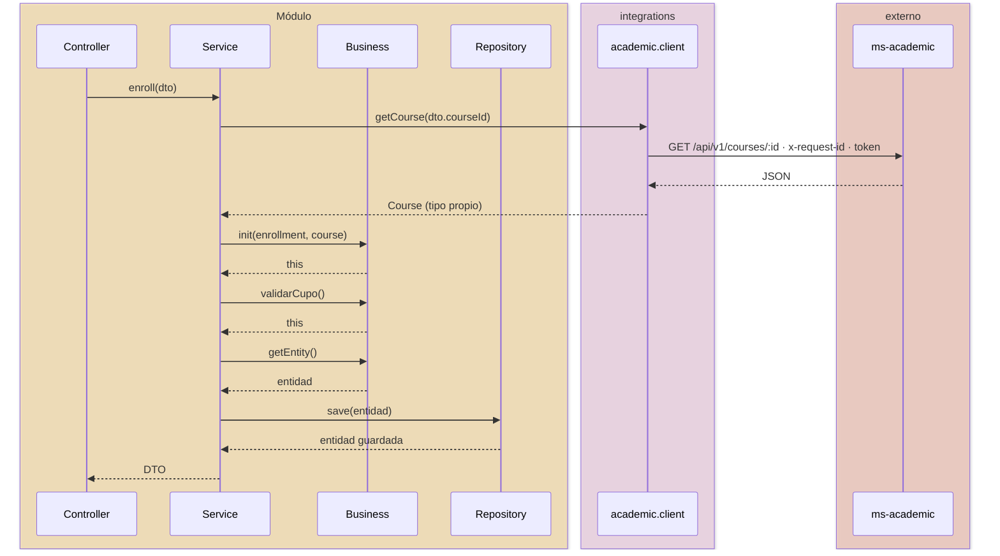

```ts
// modules/enrollment/enrollment.module.ts
@Module({ imports: [AcademicIntegrationModule, TypeOrmModule.forFeature([Enrollment])], … })

// modules/enrollment/enrollment.service.ts
const course = await this.academic.getCourse(dto.courseId);
const enrollment = this.business.init(dto, course).validarCupo().getEntity();
```

El service trae los datos externos **antes** de `init()`: el business sigue síncrono y sin E/S.

### 8.3. Integraciones: cómo crecen

| Situación                                      | Qué se hace                                                                                 |
| ---------------------------------------------- | ------------------------------------------------------------------------------------------- |
| Primera llamada a otro servicio.               | Nace `integrations/` con `common/` y el módulo de ese dominio.                              |
| Primera llamada a un dominio externo nuevo.    | Nace `integrations/<dominio>/`.                                                             |
| Un dominio externo suma muchas capacidades.    | Su módulo se divide en un client por capacidad (`courses.client.ts`, `sections.client.ts`). |
| El otro servicio se divide en dos despliegues. | El módulo del dominio apunta a dos URLs; los módulos que lo usan no cambian.                |

Un microservicio que no habla con nadie no tiene `integrations/`.

### 8.4. Reglas

**Dependencias**

1. Solo `integrations/` llama a otros servicios. Ningún módulo importa `HttpModule`, `HttpService`
   ni un cliente HTTP.
2. Los módulos y el orchestrator usan `integrations/`; `integrations/` nunca importa `modules/` ni
   `orchestrator/`.
3. Un módulo de `integrations/` representa un **dominio externo**, no un host ni una URL.
4. Los módulos de `integrations/` no se importan entre sí (salvo `common/`). Si una operación
   necesita dos dominios externos, los combina el service del módulo o el orchestrator.
5. El contrato público de un módulo de `integrations/` es su client y los tipos de `models/` fuera
   de `responses/`. El mapper y las formas crudas son privados.

**Cada llamada**

6. Tiene timeout. La URL y el timeout de cada dominio se declaran en el contrato de entorno
   (`<DOMINIO>_URL`, `<DOMINIO>_TIMEOUT_MS`) y se validan al arrancar.
7. Propaga `x-request-id` y la identidad del usuario. `common/` los toma del contexto de la
   petición (`AsyncLocalStorage`); el módulo no pasa cabeceras. Fuera de una petición (un job, un
   consumidor de eventos), se envía la identidad propia del servicio.
8. Solo se reintentan las lecturas idempotentes, como máximo una vez. Una escritura nunca se
   reintenta.
9. Si se necesitan varios recursos, se piden en una sola llamada (`getCourses(ids)`), nunca con una
   llamada por elemento dentro de un ciclo.

**Errores**

10. La respuesta del otro servicio se traduce a una excepción de dominio en
    `common/external-error.mapper.ts`:

| Respuesta externa              | Excepción                                                 | HTTP hacia el cliente          |
| ------------------------------ | --------------------------------------------------------- | ------------------------------ |
| 404 de un recurso que se buscó | `EntityNotFoundException`                                 | 404                            |
| 400 · 422                      | `BusinessRuleViolationException`, con el mensaje recibido | 422                            |
| 401 · 403                      | `ForbiddenOperationException`                             | 403                            |
| 5xx · timeout · red            | `ExternalServiceException`                                | 502; el detalle solo en el log |

**Consistencia**

11. No hay transacciones entre servicios. Una operación escribe en su propia base de datos; si otro
    servicio debe cambiar algo como consecuencia, se publica un evento ([§11](#11-eventos)).
12. Si el negocio exige una escritura síncrona en otro servicio, se hace **después** de confirmar lo
    local. Si falla, lo local se deshace explícitamente o queda marcado como pendiente; nunca se
    ignora en silencio.
13. Las llamadas síncronas entre servicios no forman ciclos. Si `ms-a` llama a `ms-b`, `ms-b` se
    entera de `ms-a` por eventos.

**Lo que entra**

14. Si otro servicio necesita algo de este, llama a la API normal de sus módulos. `integrations/`
    solo maneja lo que sale.

### 8.5. Integraciones: pruebas

- **Client:** se prueba contra HTTP simulado (`nock`): la ruta y las cabeceras que envía, el tipo
  propio que entrega y la excepción que lanza en cada caso de la tabla de errores.
- **Service del módulo:** recibe el client simulado, igual que el repository.

### 8.6. Orquestación de procesos

La mayoría de los casos de uso no necesitan orquestador: el service del módulo coordina su
repository, su business, sus integraciones y lee de otros módulos por su service
([§6.1](#61-dependencias-entre-módulos)). Un orquestador aparece solo cuando un proceso **no
pertenece a un solo módulo**.

| Situación                                                                           | Dónde va                        |
| ----------------------------------------------------------------------------------- | ------------------------------- |
| Un módulo escribe lo suyo y lee datos de otros módulos o servicios.                 | El service del módulo.          |
| Un módulo escribe lo suyo y otros deben enterarse.                                  | El service del módulo + evento. |
| Un proceso escribe en **varios** módulos, en un orden, con pasos que pueden fallar. | `orchestrator/<proceso>/`.      |
| Un proceso necesita compensar pasos ya hechos si uno posterior falla.               | `orchestrator/<proceso>/`.      |

```
src/orchestrator/
└── enrollment-process/
    ├── enrollment-process.module.ts         # importa los módulos e integraciones que coordina
    ├── enrollment-process.controller.ts     # el endpoint del proceso
    ├── enrollment-process.orchestrator.ts   # los pasos, en orden, y su compensación
    ├── enrollment-process.orchestrator.spec.ts
    └── models/                              # DTOs de entrada y salida del proceso
```

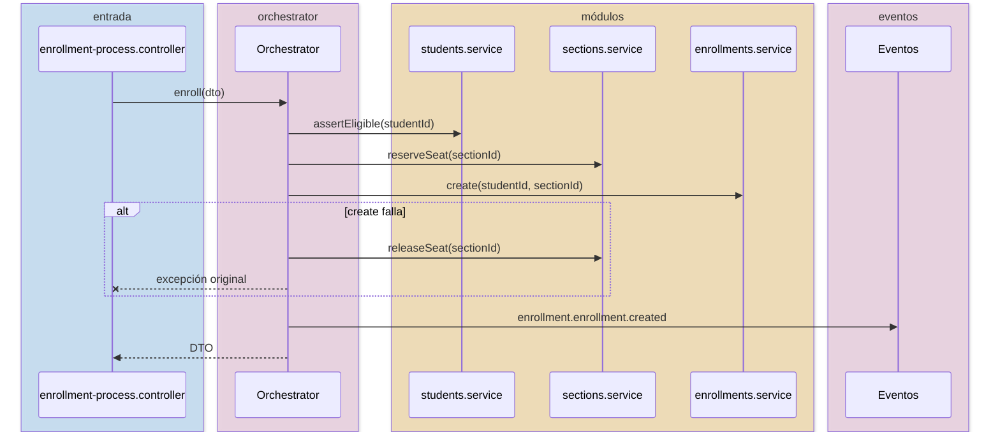

- **Coordina, no decide.** Cada paso es una llamada al service de un módulo, y las reglas viven en
  el business de ese módulo. Si el orquestador tiene un `if` de negocio, la regla está fuera de
  lugar.
- **Tiene su propio controller.** Los módulos no lo importan: si un controller de módulo llamara al
  orquestador, el orquestador dependería del módulo y el módulo del orquestador.
- **Los endpoints de los módulos siguen siendo directos.** El orquestador solo agrega el endpoint del
  proceso; no envuelve las operaciones simples.
- **Transacción si se puede, compensación si no.** Si todos los pasos escriben en la base de datos
  del propio servicio, el proceso corre en una sola transacción, con un contexto transaccional que
  comparten los repositories (por ejemplo `typeorm-transactional`); el orquestador no toca
  `DataSource`. Los pasos que no pueden entrar en esa transacción (una integración, otro dominio)
  tienen su paso inverso en el dueño (`reserveSeat` → `releaseSeat`) y se compensan en orden
  inverso. Si la compensación también falla, el proceso queda marcado como pendiente y se registra;
  nunca se ignora en silencio.
- **Un orquestador no llama a otro orquestador.** Si dos procesos comparten pasos, los pasos
  comunes son operaciones de un módulo.
- Uno por proceso, nombrado por el proceso (`enrollment-process`), no por el módulo.
- Se prueba con los services simulados: el orden de los pasos y la compensación de cada fallo.

## 9. Arranque y entornos

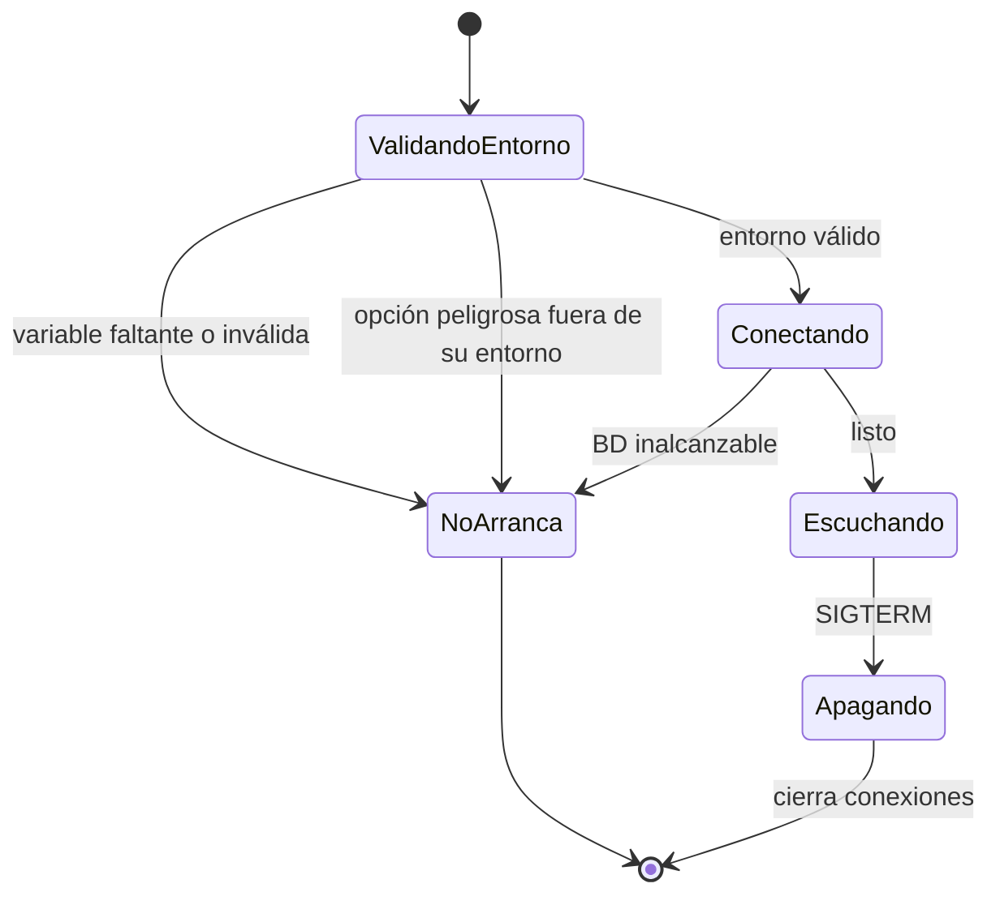

- Hay exactamente tres entornos: `dev`, `qa` y `prod`. Cualquier otro valor impide arrancar.
- Toda variable de entorno se declara y valida en un solo contrato. Si falta o es inválida, el
  proceso no levanta y el error dice cuál.
- Lo que depende del entorno (docs publicadas, `synchronize`, detalle de errores) se decide por el
  entorno, no por una variable suelta: la variable solo puede **apagar** algo, nunca encenderlo
  fuera de los entornos permitidos.
- El proceso atiende `SIGTERM` y cierra conexiones antes de salir.

## 10. Dónde ubicar el código

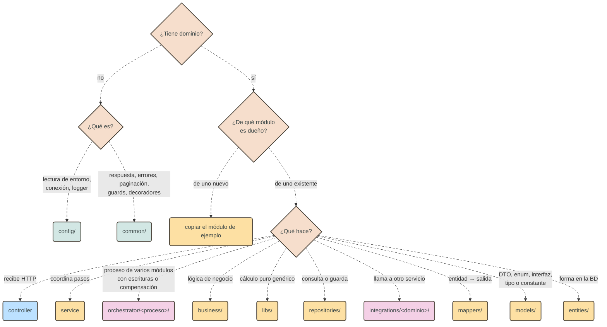

Un parámetro de negocio (umbral, tasa) vive como constante en el business; pasa a `config/` solo
cuando debe cambiar por entorno. Un cálculo que expresa una regla de negocio va al business; un
cálculo puro genérico va a `libs/` del módulo, y baja a `common` cuando lo necesita más de un
módulo. Una utilidad sin dominio que no es un cálculo (formatear, parsear) va a `common` aunque hoy
tenga un solo consumidor. Una pieza con dominio se queda en el módulo dueño aunque otro la necesite: el otro la
consume por su contrato público ([§6.1](#61-dependencias-entre-módulos)).

## 11. Eventos

Se usa un evento en vez de una llamada cuando:

| Situación                                                                     | Por qué no una llamada                                     |
| ----------------------------------------------------------------------------- | ---------------------------------------------------------- |
| Otro servicio solo necesita enterarse (notificar, auditar, actualizar datos). | Al productor no le importa quién reacciona.                |
| Dos servicios se necesitarían mutuamente.                                     | Una de las dos direcciones pasa a eventos: no hay ciclos.  |
| Un servicio lee datos de otro con mucha frecuencia.                           | Mantiene una proyección local alimentada por eventos.      |
| Una operación debe cambiar datos de otro servicio sin bloquear la propia.     | No hay transacciones entre servicios ([§8.4](#84-reglas)). |

- **Nombre:** `<dominio>.<entidad>.<hecho en pasado>` (`identity.user.created`). Nunca un
  imperativo: eso es un comando, y un comando no se publica como evento.
- **Dueño:** el módulo que lo publica declara su esquema en `modules/<x>/events/`. Los consumidores
  se adaptan.
- **Contenido mínimo:** identificadores y los datos del hecho, no la entidad completa.
- **Consumo idempotente:** un evento puede llegar más de una vez; el consumidor descarta los
  duplicados.

El sobre del evento, la publicación confiable (outbox) y el broker quedan pendientes de definir.
