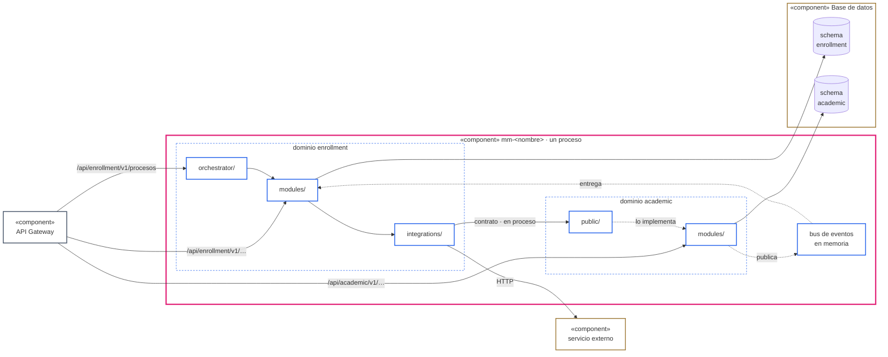
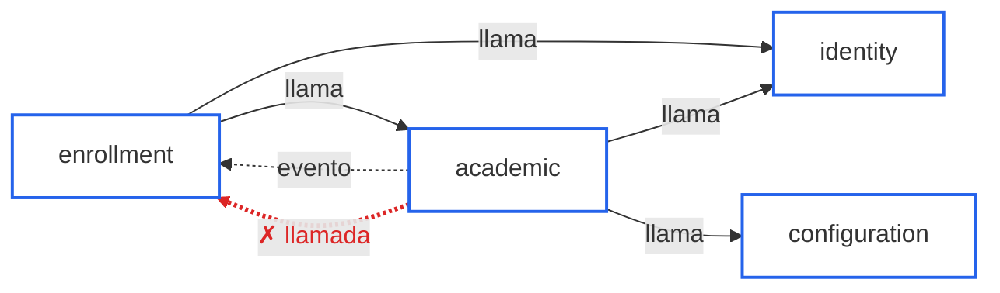
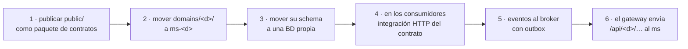

# Lineamientos de arquitectura de monolito modular (backend)

Arquitectura de referencia para un **monolito modular** (`mm-<nombre>`): un solo despliegue con
varios dominios. Cada dominio se organiza como un microservicio de la
[guía del microservicio modular](modular-microservice.md), cuyas §4 a §11 se aplican sin cambios
dentro de él. Esta guía agrega solo lo que ocurre **entre** dominios.

La frontera entre dominios se trata como la frontera entre servicios, para que extraer un dominio
cambie integraciones, bindings y datos, no sus módulos ni los de los demás
([§8](#8-extraer-un-dominio)).

> **MS §x** remite a la sección x de la [guía del microservicio modular](modular-microservice.md).
> **§x** sin prefijo remite a esta guía.

## 1. Modelo conceptual

| Concepto             | Qué es                                                                                                                                  | Dónde vive                            | Obligatorio                     |
| -------------------- | --------------------------------------------------------------------------------------------------------------------------------------- | ------------------------------------- | ------------------------------- |
| **Dominio**          | Contexto de negocio dueño de sus módulos, sus datos y sus contratos.                                                                    | `domains/<d>/`                        | Sí                              |
| **Módulo**           | Una capacidad del dominio, con la anatomía de la [MS §4](modular-microservice.md#4-anatomía-de-un-módulo) y sus propios endpoints HTTP. | `domains/<d>/modules/<x>/`            | Sí                              |
| **Contrato público** | Lo que el dominio **ofrece** a otros dominios del mismo proceso: una `abstract class` por capacidad y sus modelos.                      | `domains/<d>/public/`                 | Cuando otro dominio lo necesita |
| **Integración**      | El **único punto** por el que el dominio consume algo de afuera: otro dominio del monolito o un servicio externo.                       | `domains/<d>/integrations/<origen>/`  | Cuando consume algo de afuera   |
| **Orquestador**      | Coordina un proceso de varios pasos que no pertenece a un solo módulo ([MS §8.6](modular-microservice.md#86-orquestación-de-procesos)). | `domains/<d>/orchestrator/<proceso>/` | No                              |
| **Evento**           | Hecho ya ocurrido que el dominio publica; su esquema es parte del contrato público ([MS §11](modular-microservice.md#11-eventos)).      | `domains/<d>/public/events/`          | No                              |

| Frontera    | Dureza                             | Qué la cruza                                                                                                            |
| ----------- | ---------------------------------- | ----------------------------------------------------------------------------------------------------------------------- |
| **Módulo**  | Blanda: dentro del dominio.        | Su service y sus `models/dto` y `models/enums` ([MS §6](modular-microservice.md#6-reglas-de-dependencia-y-privacidad)). |
| **Dominio** | Dura: como si fuera otro servicio. | Solo su `public/`, y solo hacia `integrations/` del dominio que consume.                                                |



## 2. Estructura

```
architecture/
└── domains.json                          # manifiesto: qué dominio depende de cuál (§6)
src/
├── domains/
│   ├── academic/
│   │   ├── academic-domain.module.ts     # importa sus módulos, su public y sus piezas opcionales
│   │   ├── public/                       # lo único que otro dominio puede importar
│   │   │   ├── academic-public.module.ts # vincula cada contrato con su implementación · los exporta
│   │   │   ├── courses.contract.ts       # un contrato por capacidad
│   │   │   ├── seats.contract.ts
│   │   │   ├── models/                   # tipos de los contratos: serializables
│   │   │   └── events/                   # esquemas de los eventos que publica
│   │   ├── modules/                      # anatomía de la MS §4
│   │   ├── integrations/                 # todo lo que consume de afuera: §4
│   │   │   ├── identity/                 # otro dominio del monolito (en proceso)
│   │   │   └── mailer/                   # servicio externo (HTTP)
│   │   ├── orchestrator/                 # opcional: MS §8.6
│   │   └── migrations/                   # solo tablas de su schema
│   └── enrollment/
│       └── …
├── common/                               # compartido por todos los dominios, sin dominio
├── config/
└── app.module.ts                         # importa los <d>-domain.module
```

- `integrations/<origen>/` nace con la primera dependencia hacia ese origen. `orchestrator/` y
  `public/` nacen cuando hacen falta: un dominio que nadie consume no tiene `public/`.
- `common/` y `config/` son de todos y no tienen dominio, igual que en el microservicio. Si algo de
  `common/` necesita conocer un dominio, no es de `common/`.

**Capas.** Dentro de cada dominio rigen las capas de la
[MS §3](modular-microservice.md#3-capas). Solo cambia esto:

| Capa           | Además de lo que dice MS §3                                                                                                                                       | Nunca                                           |
| -------------- | ----------------------------------------------------------------------------------------------------------------------------------------------------------------- | ----------------------------------------------- |
| `integrations` | Consume también otros dominios del monolito: depende de su `public/`, solo si están en su `calls` o `subscribes` ([§6](#6-dependencias-entre-dominios-y-ciclos)). | `modules/` ni `orchestrator/` de ningún dominio |
| `modules`      | Recibe lo de otros dominios solo a través de `integrations/` de su dominio ([§4](#4-integraciones-la-única-entrada-de-lo-ajeno)).                                 | Importar otro dominio                           |
| `orchestrator` | Igual que `modules`: lo de otros dominios llega por `integrations/`.                                                                                              | Importar otro dominio                           |
| `public`       | Capa nueva: vincula sus contratos con los services de sus propios módulos ([§3](#3-contratos-públicos)).                                                          | Importar otro dominio                           |

Entre módulos del **mismo** dominio no hay integración: se usa el contrato público del otro módulo,
como en la [MS §6.1](modular-microservice.md#61-dependencias-entre-módulos).

## 3. Contratos públicos

Un contrato lo **declara quien ofrece la capacidad**, en su `public/`, y lo **implementa el service
del módulo dueño**. No hay una clase intermedia que solo reenvíe.

```ts
// domains/academic/public/courses.contract.ts
export abstract class CoursesContract {
  abstract getCourse(id: string): Promise<CourseSummary>;
  abstract getCourses(ids: string[]): Promise<CourseSummary[]>;
}

// domains/academic/public/models/course-summary.ts
export interface CourseSummary {
  id: string;
  code: string;
  capacity: number;
  startsAt: string; // ISO 8601
}

// domains/academic/modules/course/course.service.ts
@Injectable()
export class CourseService implements CoursesContract {
  async getCourse(id: string): Promise<CourseSummary> {
    const course = await this.repository.findOneById(id);
    return this.mapper.toSummary(course);
  }
  // …
}

// domains/academic/public/academic-public.module.ts
@Module({
  imports: [CourseModule, SectionModule],
  providers: [
    { provide: CoursesContract, useExisting: CourseService },
    { provide: SeatsContract, useExisting: SectionService },
  ],
  exports: [CoursesContract, SeatsContract],
})
export class AcademicPublicModule {}

// domains/enrollment/modules/enrollment/enrollment.module.ts
@Module({ imports: [AcademicIntegrationModule, …], … }) // su integración (§4), nunca AcademicPublicModule

// domains/enrollment/modules/enrollment/enrollment.service.ts
constructor(private readonly courses: CoursesContract) {}
```

- **Uno por capacidad**, no uno por dominio (`CoursesContract`, `SeatsContract`). Si un contrato
  junta operaciones de agregados distintos, se divide.
- **El token es la `abstract class`.** El consumidor inyecta el contrato y usa sus modelos; nunca
  `CourseService`. Los recibe a través de su integración, que es la única que importa `public/`.
- **`useExisting` reutiliza el service del módulo.** Si su firma no calza con el contrato sin
  deformarlo, un `public/<capacidad>.provider.ts` lo implementa traduciendo; esa traducción es su
  responsabilidad.
- **Los modelos públicos solo importan otros modelos públicos.** Nunca entidades, DTOs HTTP, enums
  privados ni clases de `common/` con comportamiento.
- **Pensados como si fueran remotos.** Objetos planos y serializables (fechas en ISO, sin métodos,
  sin carga lazy, sin callbacks), operaciones por lote (`getCourses(ids)`) y de granularidad
  gruesa. En proceso un `for` con `getCourse` es barato; extraído, son N llamadas HTTP.
- **El dueño autoriza.** El service que implementa el contrato aplica el alcance (tenant, permisos)
  con la identidad del contexto de la petición, no solo los guards del controller: una llamada en
  proceso no pasa por esos guards y, al extraer el dominio, sí pasará por una autorización. Fuera de
  una petición (job, evento), el llamador fija una identidad de sistema explícita.
- **Evolución aditiva.** Se agregan métodos y campos opcionales; no se cambian ni se quitan. Un
  cambio que rompe crea un contrato nuevo en paralelo (`CoursesContractV2`) y el anterior se marca
  `@deprecated` hasta que el manifiesto no muestre consumidores.

## 4. Integraciones: la única entrada de lo ajeno

Todo lo que un dominio consume de afuera entra por `domains/<consumidor>/integrations/<origen>/`, sea
**otro dominio del monolito** o un **servicio externo**. Los módulos y el orquestador importan el
`<Origen>IntegrationModule`; nunca `public/` de otro dominio ni un client HTTP de otra parte. Así
hay una sola forma de consumir, y el día que un origen cambia de lugar solo cambia su integración.

```
domains/enrollment/integrations/
├── common/                              # base HTTP de la MS §8: solo si hay orígenes por HTTP
├── academic/                            # otro dominio del monolito
│   ├── academic-integration.module.ts
│   └── events.ts                        # reexporta los esquemas de eventos que escucha
└── payments/                            # servicio externo: igual que en la MS §8.1
    ├── payments-integration.module.ts
    ├── payments.client.ts
    ├── mappers/
    └── models/
```

| Origen                    | Forma mínima                                                                                                            | Cuando cambia de lugar                                               |
| ------------------------- | ----------------------------------------------------------------------------------------------------------------------- | -------------------------------------------------------------------- |
| Otro dominio del monolito | Un module que importa y reexporta `<Origen>PublicModule`, sin clases.                                                   | Al extraerse, el mismo module implementa el mismo contrato por HTTP. |
| Servicio externo          | Module, client, mappers y models, con las reglas de la [MS §8](modular-microservice.md#8-integraciones-y-orquestación). | —                                                                    |

```ts
// domains/enrollment/integrations/academic/academic-integration.module.ts
// academic en el monolito
@Module({ imports: [AcademicPublicModule], exports: [AcademicPublicModule] })
export class AcademicIntegrationModule {}

// academic ya extraído: cambia solo este archivo
@Module({
  imports: [HttpModule.registerAsync(…)],
  providers: [{ provide: CoursesContract, useClass: CoursesHttpClient }],
  exports: [CoursesContract],
})
export class AcademicIntegrationModule {}

// domains/enrollment/integrations/academic/events.ts
export { COURSE_CLOSED, type CourseClosedEvent } from '@domains/academic/public/events';
```

**Cuándo una integración hacia otro dominio agrega una clase**, además del module:

| Necesidad concreta                                                           | Qué agrega                                                                                                            |
| ---------------------------------------------------------------------------- | --------------------------------------------------------------------------------------------------------------------- |
| Usar el contrato del otro dominio tal como viene.                            | Nada: el module reexporta el contrato.                                                                                |
| El modelo del otro dominio no calza con el propio y la traducción se repite. | `<origen>.client.ts` que inyecta el contrato y entrega tipos propios.                                                 |
| Una operación combina varios contratos del otro dominio.                     | `<origen>.client.ts` que los combina.                                                                                 |
| El otro dominio ya fue extraído.                                             | `<Capacidad>HttpClient` que implementa el **mismo contrato** por HTTP ([MS §8.4](modular-microservice.md#84-reglas)). |

- **El module que reexporta no es una capa que reenvía.** No tiene clases ni métodos: su
  responsabilidad es ser el único lugar donde se decide si el origen está en proceso o es remoto.
- **Una clase que solo reenvía métodos** sin traducir, combinar ni salir por HTTP no se crea.
- **Los eventos de otro dominio también entran por aquí.** El listener vive en el módulo que
  reacciona ([MS §11](modular-microservice.md#11-eventos)), pero importa el nombre y el esquema del evento desde `integrations/<origen>/`,
  nunca desde `public/` del otro dominio.
- **Una integración nunca contiene reglas de negocio** del dominio que consume y nunca importa sus
  `modules/` ni su `orchestrator/` ([MS §3](modular-microservice.md#3-capas)).
- **Las excepciones de `common/` cruzan tal cual en proceso.** La implementación HTTP produce las
  mismas con la tabla de la [MS §8.4](modular-microservice.md#84-reglas), así que el consumidor no distingue de dónde vino.
- **No se separa en `internal/` y `external/`.** La carpeta lleva el nombre del origen, no su
  ubicación: un dominio que se extrae pasa de interno a externo, y separarlas obligaría a mover la
  carpeta y cambiar los imports de cada módulo consumidor, justo lo que esta sección evita. Si un
  origen es otro dominio del monolito lo dice el manifiesto ([§6](#6-dependencias-entre-dominios-y-ciclos)): está en su `calls`.

## 5. Orquestación entre dominios

Un orquestador ([MS §8.6](modular-microservice.md#86-orquestación-de-procesos)) vive en el dominio **dueño del proceso** y usa contratos de otros dominios a
través de las integraciones de su dominio, igual que los módulos. Además de las reglas de la [MS §8.6](modular-microservice.md#86-orquestación-de-procesos):

- **Los contratos los implementan services o providers, nunca orquestadores.** Así ningún dominio
  puede llamar al orquestador de otro y no se forman cadenas de orquestadores entre dominios.
- **Los pasos de otros dominios no entran en la transacción local.** Se ordenan para escribir
  primero lo propio, cada paso remoto tiene su compensación en el dominio dueño y un fallo de la
  compensación deja el proceso marcado como pendiente.
- **Lo que no necesita respuesta inmediata va por evento**, no como un paso más del orquestador.

## 6. Dependencias entre dominios y ciclos

Entre dominios hay tres tipos de dependencia, con riesgos distintos:

| Tipo            | Ejemplo                                             | Riesgo si forma un ciclo                                               | Regla                                                 |
| --------------- | --------------------------------------------------- | ---------------------------------------------------------------------- | ----------------------------------------------------- |
| **Estructural** | `enrollment/integrations` importa `academic/public` | No se puede compilar, probar ni extraer un dominio sin el otro.        | DAG obligatorio                                       |
| **Síncrona**    | `enrollment` llama a `CoursesContract`              | Recursión entre dominios; al extraer, latencia y fallos en cascada.    | DAG obligatorio                                       |
| **Asíncrona**   | `enrollment` escucha `academic.course.closed`       | Bucles de eventos que se realimentan; consistencia que nunca converge. | Ciclos permitidos solo si están declarados y terminan |

Un ciclo no es un deadlock por sí mismo; lo que produce es acoplamiento: dos dominios que solo
pueden cambiar, desplegarse y extraerse juntos.



**Manifiesto.** Las dependencias permitidas se declaran en `architecture/domains.json`. Una
dependencia nueva es un cambio del manifiesto, revisado como cualquier otro:

```json
{
  "identity": { "calls": [], "subscribes": [] },
  "configuration": { "calls": [], "subscribes": [] },
  "academic": { "calls": ["identity", "configuration"], "subscribes": [] },
  "enrollment": { "calls": ["academic", "identity"], "subscribes": ["academic"] }
}
```

**Verificación en CI** (`npm run arch:check`, obligatorio para integrar):

1. **dependency-cruiser**, con reglas generadas desde el manifiesto:
   - solo `integrations/` importa `public/` de otro dominio, y solo de los dominios en su `calls`
     o `subscribes`;
   - `modules/` y `orchestrator/` nunca importan otro dominio;
   - `public/models` y `public/events` solo importan otros archivos de `public/`;
   - `modules/` no importa `orchestrator/`; un orquestador no importa otro orquestador;
   - sin imports circulares (`no-circular`) en todo `src/`.
2. **Grafo del manifiesto:** `calls` debe ser acíclico, incluidos los ciclos indirectos (A → B → C →
   A). El script falla con el camino del ciclo.
3. **`forwardRef` prohibido** fuera de `common/` (regla de ESLint `no-restricted-syntax`): en Nest es
   la forma habitual de esconder un ciclo.
4. **Suscripciones:** cada evento de otro dominio que reexporta `integrations/<origen>/events.ts`
   debe estar en su `subscribes`. Un ciclo en el
   grafo de eventos se rechaza salvo que el manifiesto lo marque con su condición de término.

Detectar ciclos de imports no basta: un binding o un evento puede crear una dependencia que el
grafo de imports no muestra. Por eso el manifiesto es la fuente y los imports se validan contra él.

**Si aparece un ciclo**, en este orden:

1. La pieza que ambos necesitan baja a un tercer dominio o, si no tiene dominio, a `common/`.
2. Una de las direcciones pasa a evento, declarado en `subscribes`.
3. Si los dos dominios siempre cambian juntos, la frontera está mal trazada y se fusionan.

## 7. Datos y consistencia

1. Cada dominio tiene su propio schema (o prefijo de tabla, si el motor no tiene schemas) y sus
   propias migraciones.
2. Entre dominios no hay FKs, relaciones del ORM ni joins. De otro dominio solo se guarda el id.
3. No hay transacciones entre dominios, aunque compartan la conexión. Cada dominio confirma lo suyo;
   lo demás se resuelve con eventos o compensación.
4. Un evento se publica **después** del commit, nunca dentro de la transacción. Los consumidores son
   idempotentes desde el principio.
5. Un dominio no llama por HTTP a la API de otro dominio del mismo proceso: su integración usa el
   contrato en proceso.
6. Las rutas de cada dominio cuelgan de `/api/<dominio>/v1` (`RouterModule` con `path:
'<dominio>/v1'` y sus módulos como `children`, sin `enableVersioning`). Al extraer el dominio, el
   gateway envía ese prefijo al nuevo servicio.

## 8. Extraer un dominio



Extraer **no es automático**. Las reglas anteriores reducen el cambio, pero estos puntos siempre
requieren trabajo:

| Qué cambia                   | Antes (en proceso)                                       | Después (HTTP)                                                                                                                                                    |
| ---------------------------- | -------------------------------------------------------- | ----------------------------------------------------------------------------------------------------------------------------------------------------------------- |
| Contratos y modelos públicos | Las integraciones los importan de `domains/<d>/public/`. | Se publican como paquete; solo las integraciones cambian la ruta del import.                                                                                      |
| Implementación del contrato  | El service, por `useExisting`.                           | El `<Origen>IntegrationModule` de cada consumidor la cambia por un client HTTP, con timeout, reintentos y errores ([MS §8.4](modular-microservice.md#84-reglas)). |
| Autorización                 | La identidad del contexto, en memoria.                   | Token propagado e identidad de servicio entre servicios.                                                                                                          |
| Latencia y fallos            | Llamada en memoria; falla con el proceso.                | Red: timeouts, 502 y degradación; las lecturas por lote se vuelven indispensables.                                                                                |
| Consistencia                 | Eventos en memoria tras el commit.                       | Broker con outbox; consistencia eventual explícita.                                                                                                               |
| Datos                        | Mismo servidor, schema propio.                           | Base de datos propia y migración de los datos.                                                                                                                    |

Lo que **no** debería cambiar: los módulos del dominio extraído, los módulos y orquestadores de los
consumidores y los contratos. En cada consumidor cambia solo `integrations/<d>/`. Si un paso exige tocar módulos de otro dominio, una regla de esta sección se rompió
antes.

## 9. Gobierno

| Regla | Descripción                                                                                                                     | Cómo se verifica                                                  |
| ----- | ------------------------------------------------------------------------------------------------------------------------------- | ----------------------------------------------------------------- |
| AR-01 | Cada dominio es dueño de sus módulos, su schema y sus migraciones.                                                              | Revisión + migraciones por carpeta de dominio                     |
| AR-02 | Los módulos exponen sus propios endpoints HTTP, sin pasar por `public/` ni por un orquestador.                                  | Revisión                                                          |
| AR-03 | Toda comunicación con otro dominio o servicio pasa por `integrations/<origen>/`; solo ahí se importa `public/` de otro dominio. | dependency-cruiser                                                |
| AR-04 | La comunicación síncrona entre dominios usa contratos; la asíncrona, eventos de `public/events/`.                               | dependency-cruiser + manifiesto                                   |
| AR-05 | Las dependencias estructurales y síncronas entre dominios forman un DAG declarado.                                              | Script del manifiesto                                             |
| AR-06 | Los ciclos de eventos solo existen declarados y con condición de término.                                                       | Script del manifiesto                                             |
| AR-07 | Una integración no tiene clases que solo reenvían; su forma mínima hacia otro dominio es el module que reexporta.               | Revisión                                                          |
| AR-08 | Los orquestadores son opcionales, no deciden, no llaman a otros orquestadores ni implementan contratos.                         | dependency-cruiser + revisión                                     |
| AR-09 | Los modelos públicos no exponen entidades ni DTOs HTTP y son serializables.                                                     | dependency-cruiser (`public/` solo importa `public/`)             |
| AR-10 | Los contratos se diseñan como remotos: por lote, gruesos y con evolución aditiva.                                               | Revisión                                                          |
| AR-11 | El dueño del contrato autoriza; la identidad del llamador siempre es explícita.                                                 | Tests del service que implementa el contrato                      |
| AR-12 | No hay transacciones entre dominios; los eventos se publican después del commit.                                                | Revisión + tests                                                  |
| AR-13 | No hay llamadas HTTP entre dominios del mismo proceso.                                                                          | Revisión: ninguna integración apunta a la URL del propio monolito |
| AR-14 | Toda verificación automática corre en CI y bloquea la integración.                                                              | Pipeline                                                          |

## 10. Decisiones pendientes

- **Publicación confiable de eventos.** Publicar después del commit puede perder un evento si el
  proceso cae entre ambos. Un outbox lo evita; falta decidir si se adopta desde el inicio o al
  extraer el primer dominio ([MS §11](modular-microservice.md#11-eventos)).
- **Reportes que cruzan dominios.** Sin joins entre dominios, un reporte que combina varios necesita
  proyecciones locales alimentadas por eventos o un dominio de reportes con acceso de solo lectura
  documentado como excepción.
- **Nombre de `public/`.** Se mantiene mientras no choque con convenciones del framework.
